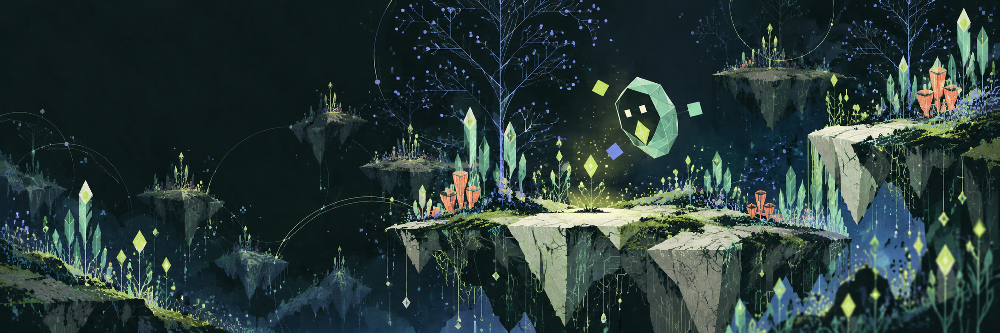
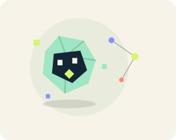
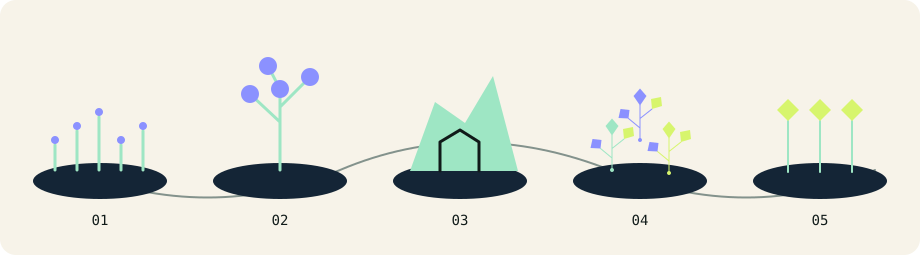
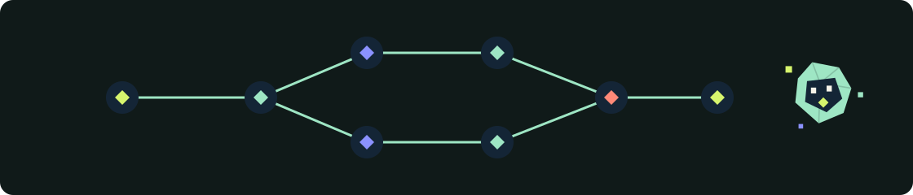
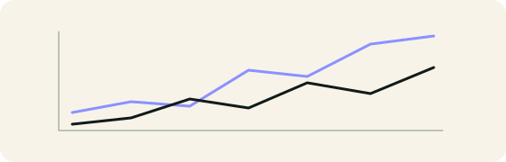
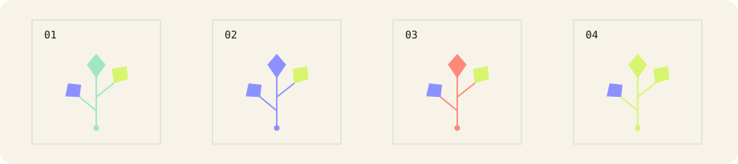
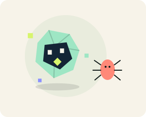
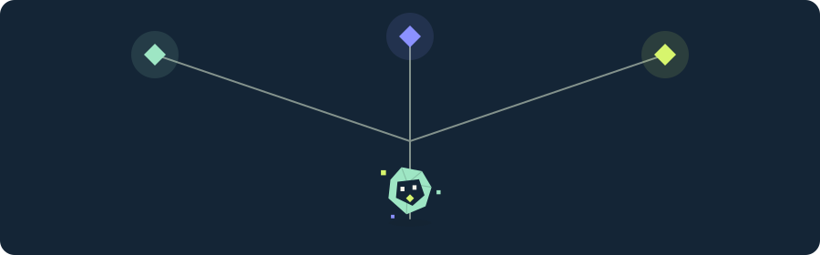
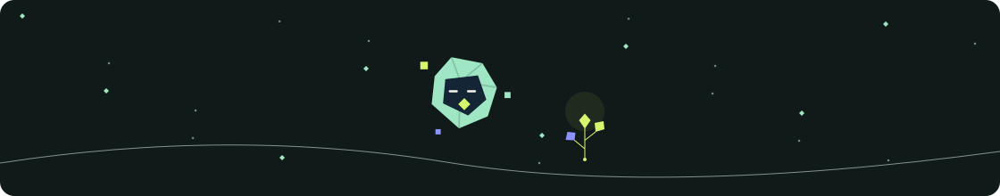

**00 / SOMETHING IS GROWING**

# THE GLITCH GARDEN

*WHERE CURIOSITY GROWS INTO CODE*

**Anshita Dawar** · Final-year B.Tech · Artificial Intelligence & Machine Learning

Python, data, practical applications — and the occasional beautifully uncooperative experiment.

[The human](#the-human) · [The ecosystem](#the-ecosystem) · **[Projects](#specimens)** · [Toolkit](#the-tool-garden) · [Next growth](#next-growth) · [Say hello](#say-hello)

> A small field guide to the things I build, the patterns I notice, and the questions that refuse to stay small.

 

## 01 / The human behind the experiments

Hi, I'm **Anshita**. I'm a final-year B.Tech student specializing in **Artificial Intelligence and Machine Learning**. I like turning messy information into something understandable, and turning “what if?” into software someone can actually use.

My projects span Python data stories, document tools, and backend systems. I'm still strengthening the fundamentals beneath them: how to design, test, explain, and reliably ship what I build. My ideas currently grow faster than my ability to name their folders.

**Already planted:** Python applications, data visualization, document comparison, and workflow orchestration prototypes.  
**Still growing:** ML foundations, resilient backend design, and better testing and deployment habits.

*NOVA is the fictional organism exploring this garden. I'm the human writing the code.*

 

## 02 / The ecosystem of ideas

| Habitat | What grows here | Follow the path |
| :-- | :-- | :-- |
| **01 · The Data Marsh** | Raw information becomes patterns, charts, and questions worth asking. | [UPI analysis](https://github.com/anshiiii-hub/upi-analysis) |
| **02 · The Neural Forest** | ML foundations and intelligent applications, explored one experiment at a time. | [Learning directions](#next-growth) |
| **03 · The Logic Caverns** | Programming fundamentals, algorithms, and the patient art of reasoning. | [Next growth cycle](#next-growth) |
| **04 · The Application Canopy** | APIs and interfaces give an idea somewhere to live. | [DocDiff](https://github.com/anshiiii-hub/DocDiff) |
| **05 · The Automation Meadow** | Repeated steps become explicit, inspectable workflows. | [ORQESTRA](https://github.com/anshiiii-hub/ORQESTRA) |

*These habitats describe interests, not a checklist of completed achievements.*

 

## 03 / Specimens: things I've built

### Specimen 001 · ORQESTRA

**A task graph with a memory of what happened.**

An orchestration prototype for running analysis through a persisted task graph, with validation, execution state, and recovery made visible. It explores how an AI-assisted workflow can remain inspectable when tasks fail or sensitive writes need review.

**Stack:** Python · FastAPI · PostgreSQL · SQLAlchemy · Pydantic · React · TypeScript · Docker

- **Durable scheduling:** a polling worker claims ready tasks with expiring leases and checks attempt ownership before publishing results.
- **Explicit execution boundaries:** validated dependencies and agent contracts; offline planning by default, with optional OpenAI planning.
- **Human review:** sensitive write tools pause for approval; the dashboard exposes workflow state, events, and outputs.

**Field note:** a prototype under development. Production readiness and hosted demos are not verified; a full autonomous coding product remains planned.

[Explore the source →](https://github.com/anshiiii-hub/ORQESTRA) · [Architecture](https://github.com/anshiiii-hub/ORQESTRA/blob/main/docs/architecture.md) · [Scheduler](https://github.com/anshiiii-hub/ORQESTRA/blob/main/docs/scheduler.md)

---

### Specimen 002 · DocDiff

**Find the change hiding between two versions.**

A Flask application that helps readers follow document revisions through paragraph-level changes and word-level highlights.

**Stack:** Python · Flask · difflib · python-docx · pdfplumber · HTML/Jinja

- Extracts text from TXT, Markdown, DOCX, and text-bearing PDFs.
- Uses `SequenceMatcher` and similarity-based pairing to classify additions, deletions, and modifications, then highlight word changes.
- Produces comparison reports with change counts; the documented summary flow supports optional Gemini assistance and a rule-based fallback.

**Field note:** reports are stored in memory. Scanned PDFs and complex layouts need additional processing.

[Explore the source →](https://github.com/anshiiii-hub/DocDiff) · [Comparison engine](https://github.com/anshiiii-hub/DocDiff/blob/main/diff_engine.py)

---

### Specimen 003 · UPI analysis

**A monthly payment dataset, made readable.**

A Flask data story exploring UPI payment volume, value, and average transaction size through interactive charts and a data table.

**Stack:** Python · Flask · pandas · Plotly · HTML

- Reads a precomputed monthly CSV and converts dates for charts and tabular display.
- Presents transaction volume versus value on separate axes, plus average transaction size and year-on-year value growth.
- Calculates month-on-month volume change with pandas `pct_change()`.

**Field note:** descriptive analysis, with no trained prediction model. The CSV must be present for analysis pages to work.

[Explore the source →](https://github.com/anshiiii-hub/upi-analysis) · [Application code](https://github.com/anshiiii-hub/upi-analysis/blob/main/app.py)

*Project descriptions are grounded in repository documentation and source inspected on 30 October 2026. No public live demo is linked here.*

 

## 04 / The tool garden

| Field classification | Tools & concepts | Evidence or direction |
| :-- | :-- | :-- |
| **01 · CULTIVATED** · used in projects | Python, Flask, pandas, Plotly | [UPI application](https://github.com/anshiiii-hub/upi-analysis/blob/main/app.py) |
| **01 · CULTIVATED** · used in projects | FastAPI, PostgreSQL, SQLAlchemy, Pydantic, React, TypeScript, Docker | [ORQESTRA architecture](https://github.com/anshiiii-hub/ORQESTRA/blob/main/docs/architecture.md) and [source](https://github.com/anshiiii-hub/ORQESTRA) |
| **01 · CULTIVATED** · used in projects | difflib, python-docx, pdfplumber, HTML/Jinja | [DocDiff](https://github.com/anshiiii-hub/DocDiff) |
| **02 · GROWING** · actively learning | ML foundations, algorithms, backend design, Git/GitHub workflow | Practice, smaller experiments, clearer explanations |
| **03 · EXPERIMENTAL** · exploring | AI-assisted planning, document summaries, recovery strategies | Optional integrations and prototypes; still evaluating the trade-offs |
| **04 · SEEDS** · future direction | More complete data pipelines, deployment practice, collaborative ML work | Turn the next useful question into a well-documented application |

*“Cultivated” means used, not mastered. No proficiency percentages; the projects are the evidence.*

 

## 05 / Unexpected mutations

**Fictional field notes from a very familiar ecosystem.**

<strong>Incident M-01 · The multiplying bug</strong>

**Observation:** one fix produced three new symptoms.  
**Hypothesis:** the first bug had an extended family.  
**Experiment:** isolate the smallest failing example; change one thing.  
**Outcome:** less mystery, a useful regression case, and a smaller family reunion.

<strong>Incident M-02 · The observer effect</strong>

**Observation:** the demonstration behaved differently with an audience.  
**Hypothesis:** confidence was an undocumented dependency.  
**Experiment:** reproduce with the same inputs and capture the logs.  
**Outcome:** “works on my machine” became a question, not a conclusion.

<strong>Incident M-03 · The unusually helpful error</strong>

**Observation:** the error message contained the answer all along.  
**Hypothesis:** reading it slowly might be faster than rewriting everything.  
**Experiment:** read it slowly.  
**Outcome:** a typo became a lesson in experimental restraint.

 

## 06 / The next growth cycle

| Path | What I'm working toward | A useful next experiment |
| :-- | :-- | :-- |
| **Roots · fundamentals** | Stronger problem-solving and software design | Solve a small problem, explain the trade-offs, test the awkward cases. |
| **Branches · applications** | Practical AI/ML and backend systems | Connect a bounded data workflow to an application with clear failure behavior. |
| **Canopy · delivery** | Better tests, documentation, and deployment | Make a project easier for someone else to run and understand. |
| **Cross-pollination · collaboration** | Shared learning through projects and hackathons | Build something useful with people who ask different questions. |

*Directions in progress. No invented deadlines, completion bars, or harvest guarantees.*

 

### A little cross-pollination?

I'd love to collaborate on practical AI or data applications, small automation tools, and thoughtful hackathon projects.

[Find me on GitHub](https://github.com/anshiiii-hub) · [Wander through my repositories](https://github.com/anshiiii-hub?tab=repositories)

 

## 07 / The last seed

**EVERY IDEA STARTS SMALL.**  
Every experiment changes something. Every project leaves a trace.

There's something inside the seed.

 

An unfinished idea isn't an empty one.

Sometimes the next step is a better question. Sometimes it's a smaller experiment. Sometimes it's finally reading the documentation.

Thanks for wandering through my little ecosystem.

**THE GARDEN IS NEVER FINISHED GROWING.**

 

*plant an idea · observe the unexpected · grow an experiment*

[Anshita Dawar](https://github.com/anshiiii-hub) · [Back to the roots](#the-human)

